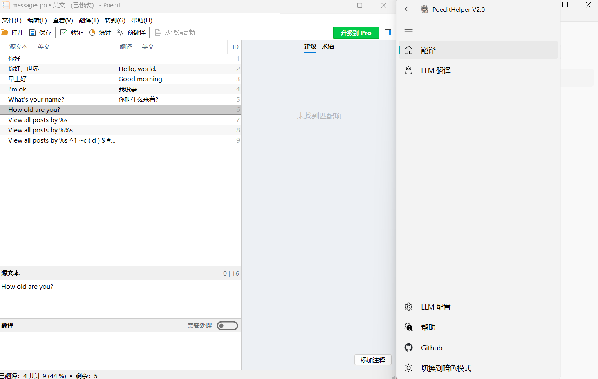
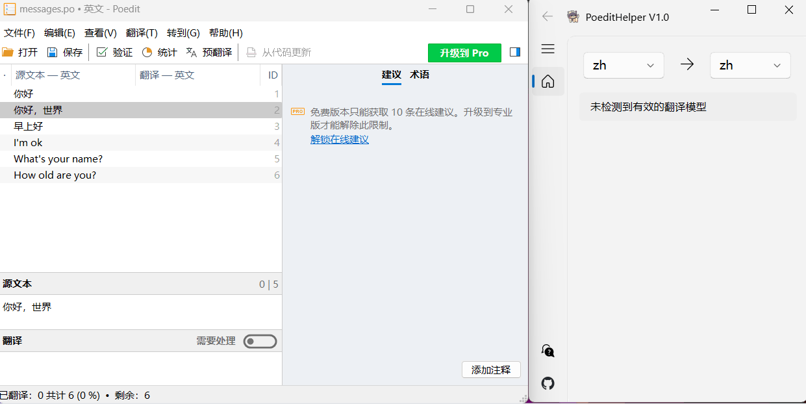

# PoeditHelper

[README_ZH](README.md)  
Poedit translation helper based on machine learning translation library.

Features:
- Machine learning model translation
- LLM large model translation
- Light/Dark mode

## LLM Translation
- Currently supported LLM providers:
  - Google AI Studio
- Before using LLM translation, configure the required token. In some regions a proxy is needed to access the service.

----

# Demo

## V2

## V1

# Model Download

Translation models for other languages can be downloaded here.  
[TranslationModelDownload]  
https://raw.githubusercontent.com/argosopentech/argospm-index/main/index.json  
[TranslationModelDownload-dev]  
https://raw.githubusercontent.com/argosopentech/argospm-index-dev/main/index.json

# Tested
- Windows11
- Python3.11
- Poedit 3.4.4

# Usage

`pip install -r requirements.txt`  
`python main.py`  
Then  
1. Open Poedit.  
2. Open PoeditHelper.  
3. Load the .po file.  
4. Select the translation type.  
5. Click the text in Poedit and PoeditHelper will translate it automatically.  
6. Click the translated text in PoeditHelper and it will fill Poedit automatically.  
